<div align="center">

[](README.md)
[](README.es.md)

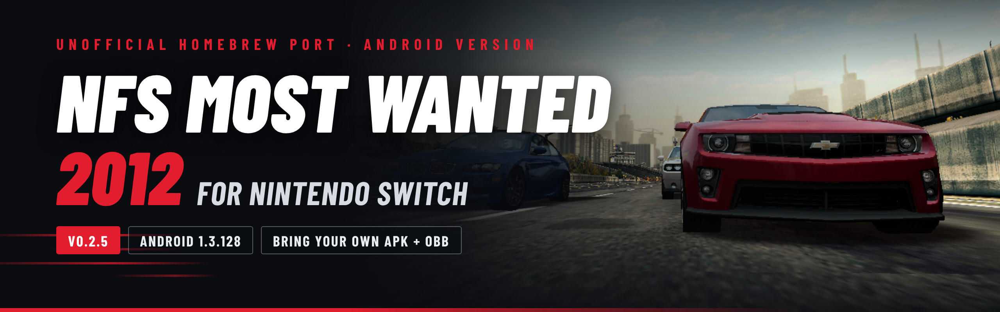

# NFS Most Wanted 2012 (Android) for Nintendo Switch

**An unofficial homebrew port of the Android version of *Need for Speed™ Most Wanted* (2012, version 1.3.128) to the Nintendo Switch.**<br>
The original Android game, loaded by a native Switch program. Bring your own copy, drop it into one
folder, and race through Fairhaven, handheld or docked.

[](../../releases)
[](../../releases)


[](LICENSE)

[Install](#how-to-install) · [Controls](#controls) · [FAQ](#faq) · [Troubleshooting](docs/INSTALL.md#troubleshooting) · [Changelog](CHANGELOG.md) · [How it works](docs/TECHNICAL.md)

</div>

> [!IMPORTANT]
> **No game files are included, not in this repository and not in the releases.** You need your
> own copy of the Android game: the APK and the OBB of version 1.3.128 (or one `.xapk` file with
> both). Please don't ask for them in issues, and never upload them anywhere.
>
> This port runs the **Android** version only. Files from the PC, PlayStation 3, Xbox 360, PS Vita,
> Wii U or iOS versions of Most Wanted (2012) don't work.

> [!TIP]
> **New in 0.3.0**
> - **Dock and undock while you play**: the resolution follows at once (720p handheld, 1080p docked).
> - **The Switch's buttons in the game**: the controls pages and tutorials say +, −, A, B, X, Y
>   instead of the MOGA gamepad's buttons, in all 11 languages, with new pictures of the controls:
>   a handheld console in handheld mode and a controller when docked ([see them](#controls)).
> - **A rare crash while loading a race is fixed.**
>
> All the details are in the [changelog](CHANGELOG.md).

## Screenshots

<table>
  <tr>
    <td width="50%">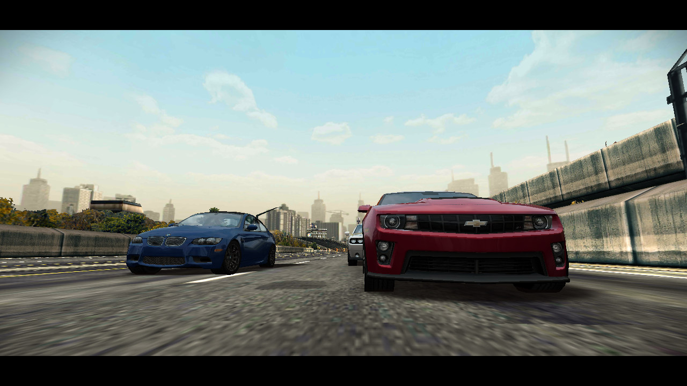</td>
    <td width="50%">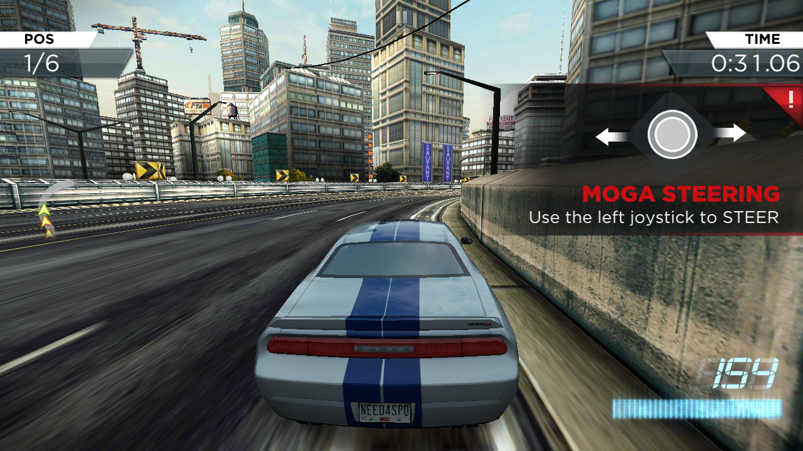</td>
  </tr>
  <tr>
    <td align="center"><sub>The race intro, rendered in real time</sub></td>
    <td align="center"><sub>Racing through Fairhaven with the controller</sub></td>
  </tr>
  <tr>
    <td>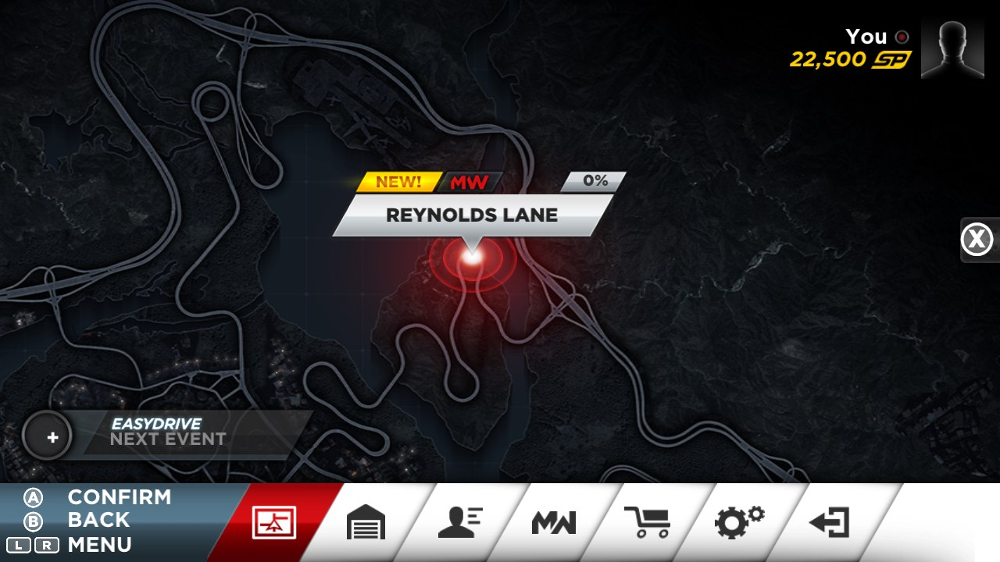</td>
    <td>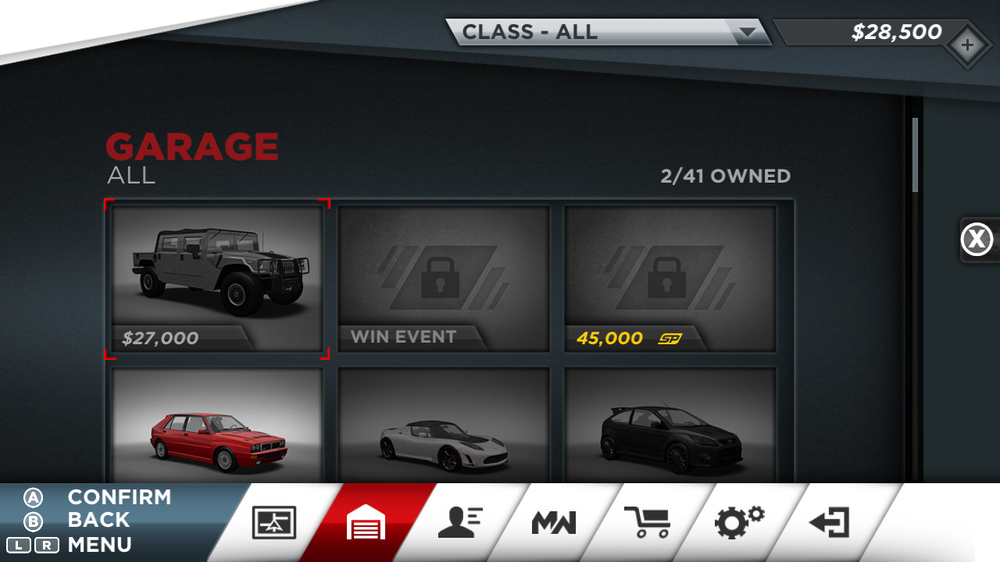</td>
  </tr>
  <tr>
    <td align="center"><sub>Every menu works with the D-pad: the highlight follows the game's style</sub></td>
    <td align="center"><sub>The garage, with on-screen button hints</sub></td>
  </tr>
  <tr>
    <td>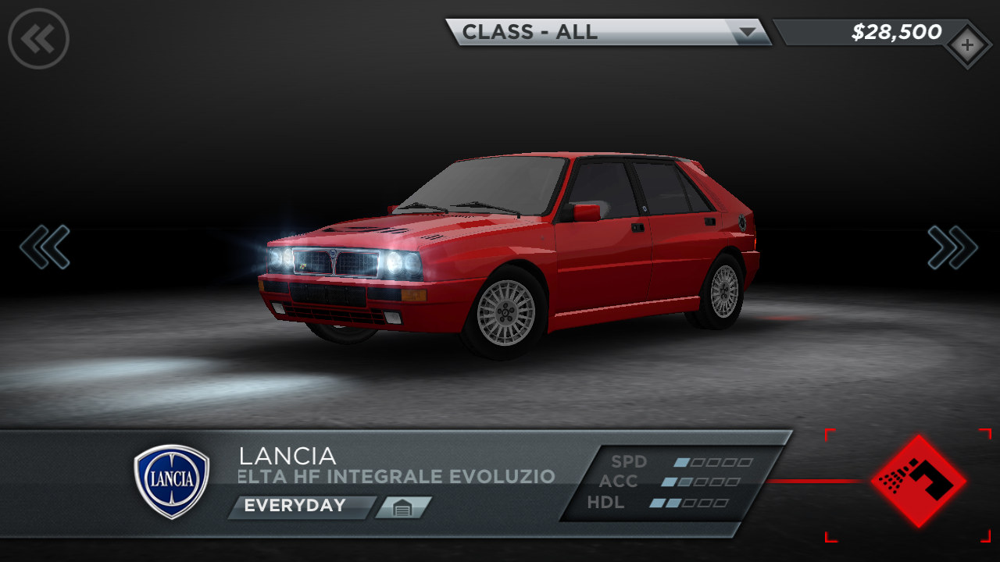</td>
    <td>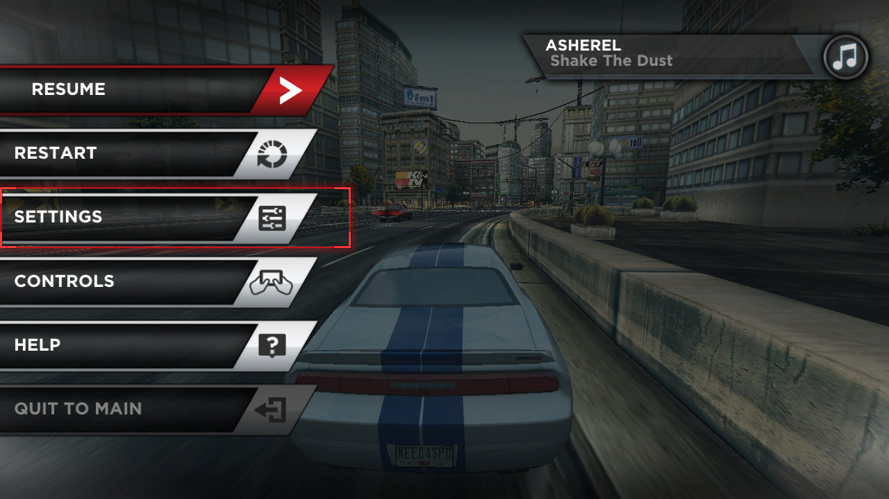</td>
  </tr>
  <tr>
    <td align="center"><sub>The 3D car showroom</sub></td>
    <td align="center"><sub>The pause menu, mid-race</sub></td>
  </tr>
</table>

<sub>Captured with the port's PC test build, which runs the same game code at the Switch's handheld
resolution (1280×720). The panel in the race shot is the game's own tutorial for controller steering.</sub>

## Features

- **The real Android game, with no phone or Android system underneath.** The port loads the game's
  own libraries, and everything the game asks Android for (files, graphics, sound, controls) is
  answered by the port's own Switch code. One part does work like an emulator: the game's 32-bit
  ARM code goes through a CPU recompiler ([Dynarmic](https://github.com/azahar-emu/dynarmic)), because
  Switch homebrew can only run 64-bit code ([why](#faq)).
- **720p in handheld mode, 1080p docked, and you can dock or undock while you play.**
- **Switch buttons in the game.** The controls pages and tutorials name the Switch's buttons instead
  of the MOGA gamepad the game was made for, in all 11 languages. The controls pages show the
  port's own drawings with the Switch's button layout: a handheld console in handheld mode, a
  gamepad when docked.
- **Full controller support.** Drive with the sticks and buttons, and play every menu with a
  highlight you move with the D-pad, drawn in the game's own style. The touch screen still works.
- **Optional gyro steering.** Tilt the console or the controller like a steering wheel.
- **Easy install, no PC needed.** Copy your APK and OBB (or a single `.xapk`) into one folder: the
  port sets itself up at the first start, with a progress screen.
- **Forgiving.** Libraries left in `lib/armeabi-v7a/`, an assets folder in the wrong place or a
  renamed OBB are moved where they belong automatically.
- **Faster with every start.** The port remembers which parts of the game's code it has translated
  (the JIT cache) and translates them ahead of time from then on: shorter loading screens and
  fewer stutters.
- **Fully offline.** Every online service is blocked; career, races, cars and saves work offline.
- **Your career in one file** (`save/progress/nfstr_save.sb`): easy to back up, kept across updates.
- **Debug menu** (ZL + ZR + Minus): frame-rate limit, VSync, 3D resolution, detail level, CPU / GPU /
  memory clocks, sound volume and a frame-rate counter.
- **Three crashes of the original game fixed** in the loader.

## What you need

| | What |
|---|---|
| **Console** | A Nintendo Switch running [Atmosphère](https://github.com/Atmosphere-NX/Atmosphere) with the Homebrew Menu. Use emuMMC and keep a backup of your SD card. |
| **Game** | Your own *Need for Speed Most Wanted* for Android, version **1.3.128**: the APK with the 32-bit build (`lib/armeabi-v7a`) and the OBB `main.1003128.com.ea.games.nfs13_row.obb` (about 650 MB). One `.xapk` file with both works too. |
| **SD card** | About 1 GB free. |
| **PC** | Not needed. |

## How to install

> [!TIP]
> **New to Switch homebrew?** First set up your console with custom firmware (Atmosphère) and the
> Homebrew Menu: the community guide [switch.hacks.guide](https://switch.hacks.guide/) explains it
> step by step. Unsure what APK, OBB or emuMMC mean? See the [glossary](docs/INSTALL.md#glossary).

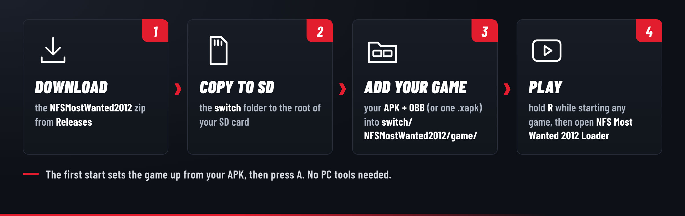

1. **Download.** On the [Releases](../../releases) page, under **Assets**, download
   `NFSMostWanted2012-0.3.0.zip` (not "Source code", which is only for developers) and unzip it on
   your computer.
2. **Copy to the SD card.** Copy the `switch` folder from the zip to the root of your SD card.
3. **Add your game.** Copy your APK and your OBB into `switch/NFSMostWanted2012/game/`. Don't unzip or
   rename them. If your copy is a single `.xapk` file, copy just that. Don't have them as files yet?
   Here's [how to get them from your own phone](docs/INSTALL.md#getting-the-files-from-your-own-phone).
4. **Play.** Hold **R** while you launch any game to open the Homebrew Menu, then choose
   **NFS Most Wanted 2012 Loader**. The first start sets the game up from your APK (a few seconds, or
   about a minute for an `.xapk`). Press **A** and you're racing.

> [!WARNING]
> Always open the Homebrew Menu with **R + a game** (title takeover). From the Album, homebrew only
> gets about 440 MB of memory, which is not enough for the game.

<details>
<summary><b>What the folder looks like after the first start</b></summary>

```
sd:/switch/NFSMostWanted2012/
├── NFSMostWanted2012-0.3.0.nro   the port
├── README.txt                    the player's guide
├── LICENSES.txt                  open-source components and their licenses
├── game/                         YOUR game files (never share them)
│   ├── main.1003128.com.ea.games.nfs13_row.obb   the OBB, unchanged
│   ├── <your APK>.apk            can be deleted after the first start
│   ├── lib/                      the game's 5 libraries, taken out of the APK
│   └── assets/                   the APK's assets, taken out of the APK
├── save/
│   ├── progress/                 your career: money, reputation, cars, events
│   └── settings/                 the game's own settings (language, ...)
├── cache/                        the port's own cache: makes later starts load faster (safe to delete)
├── source/                       the port's source code (not needed to play)
├── settings.ini                  the port's settings (also changed in the debug menu)
└── log.txt                       what happened at the last start: attach it to bug reports
```

</details>

The [full install guide](docs/INSTALL.md) covers updating, backups, the optional PC script that also
gives the port the game's own icon, and [troubleshooting](docs/INSTALL.md#troubleshooting).

### Updating

Copy the `switch` folder of the new release over the old one: `game/`, `save/` and your settings are
kept, and the new version removes the old `.nro` by itself. Coming from an older version in
`switch/NFSMostWanted/` (0.1.0 to 0.2.0)? Copy the new folder and start it: your game files and
progress are moved over automatically.

## Controls

**Driving**: the port hands the game a MOGA Pro gamepad, which it supports natively. Since 0.3.0 the
game's controls pages and tutorials show the Switch's buttons (+ and − instead of Start and Select).

In the game, the pause menu's **CONTROLS** shows them, with a picture that matches how you play: a
handheld console in handheld mode, a controller when docked (it changes when you dock or undock).

<table>
  <tr>
    <td width="50%">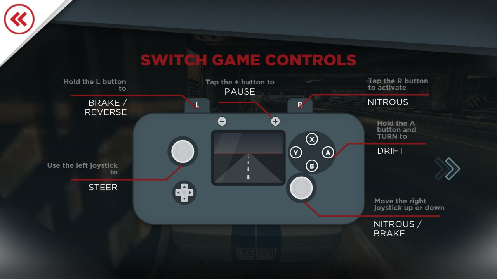</td>
    <td width="50%">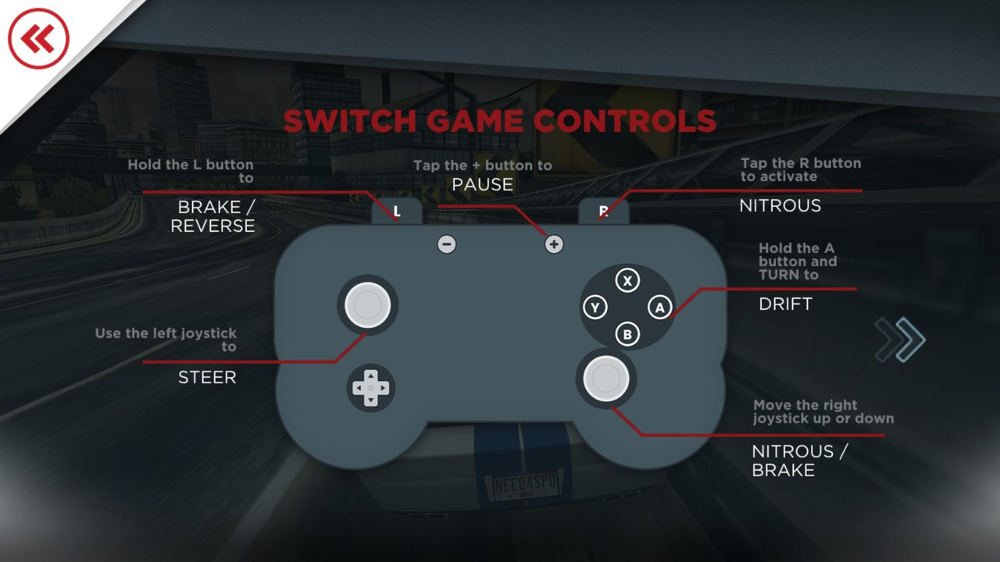</td>
  </tr>
  <tr>
    <td align="center"><sub>Game controls, handheld mode</sub></td>
    <td align="center"><sub>Game controls, docked</sub></td>
  </tr>
  <tr>
    <td>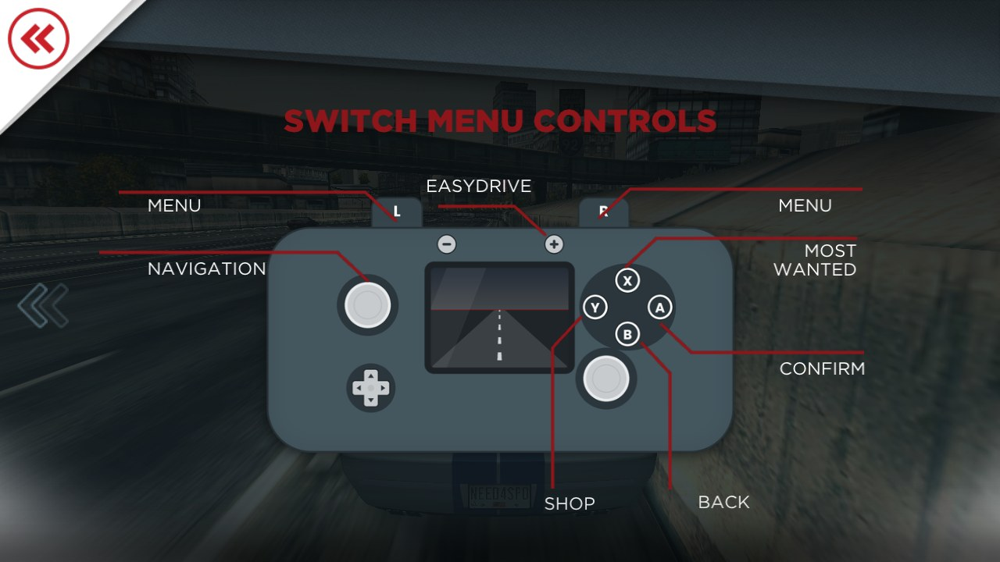</td>
    <td>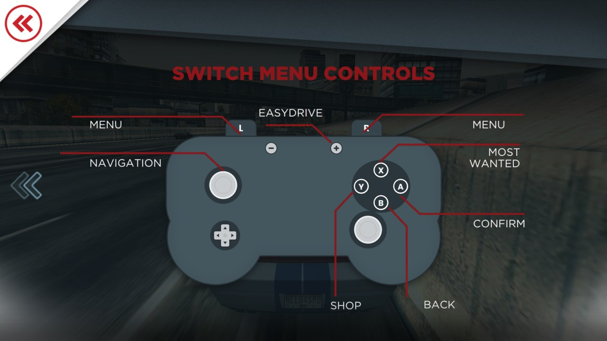</td>
  </tr>
  <tr>
    <td align="center"><sub>Menu controls, handheld mode</sub></td>
    <td align="center"><sub>Menu controls, docked</sub></td>
  </tr>
</table>

<sub>The pictures are the port's own drawings, with the Switch's button layout: similar to a Switch,
but not the same, on purpose ([why](#faq)).</sub>

| Switch | Game |
|---|---|
| Left stick | Steer |
| A | Drift |
| L, or right stick down | Brake / reverse |
| R, or right stick up | Nitro |
| + | Pause |

**Menus**

| Switch | Game |
|---|---|
| D-pad / left stick | Move the highlight (at the edge of a list: scroll) |
| A | Press the highlighted button |
| B | Back |
| L / R, then A | Pick a page in the bottom menu bar |
| Right stick | Drag like a finger: scroll lists, pan the map |
| + | EasyDrive (start the next event) on the map |
| Touch screen | Works as on a phone |

**Gyro steering**: in the game, *Options > Controls > TILT TO STEER*. Hold the console level to drive
straight; about 30° of tilt is full lock. All buttons keep working.<br>
**Debug menu**: hold **ZL + ZR** and press **Minus**. Changes are saved at once in `settings.ini`.

## Status

> [!NOTE]
> **Experimental.** The whole game runs on the Switch, but this is an early release. Back up your
> SD card and use emuMMC.

| Part | State |
|---|---|
| Career, races, garage and cars | ✅ Works |
| Every menu with the controller, touch screen | ✅ Works |
| Music and sound effects | ✅ Works |
| Saves (kept across updates) | ✅ Works |
| 720p handheld / 1080p docked | ✅ Works |
| Docking and undocking while you play | 🧪 New in 0.3.0: the resolution follows at once. Feedback welcome |
| Frame rate | ⚠️ Still being tuned on real hardware: the game targets 30 fps, and busy races can drop below that at stock clocks. The debug menu can raise the CPU clock. 0.2.6 and 0.2.7 remove the main causes of short stutters found so far. |
| Loading | ✅ Faster since 0.2.7, most of all from the second start on (the JIT cache) |
| Gyro steering, custom clocks | 🧪 New, not yet confirmed on many consoles: feedback welcome |
| Online features (Autolog, leaderboards, EA account, store) | ❌ Not available: the port is offline by design |

**Known issues**
- The very first test build froze a console once (the cause is not known; later builds have not
  done it in testing so far).

See the [changelog](CHANGELOG.md) for what changed in each version.

## FAQ

<details>
<summary><b>Is this an emulator?</b></summary>

**For the CPU, yes; for everything else, no.**

The game is a 32-bit ARM program (`armeabi-v7a`). The Switch's processor can run 32-bit ARM code,
but only in a program that is 32-bit from start to end, and Switch homebrew is 64-bit only: the
Homebrew Menu, libnx and the Mesa graphics driver the port is built on don't exist in 32-bit. So
the port runs the game's code through [Dynarmic](https://github.com/azahar-emu/dynarmic), the CPU
recompiler from 3DS emulators. Each piece of the game's code is translated into the Switch's
64-bit ARM code once, the first time it runs, and the Switch then runs that translation directly.
That is the same technique an emulator uses for its CPU, and it is the one part of the port that
works like one. The JIT cache remembers what was translated, so later starts do it ahead of time.

Nothing else is emulated. There is no phone and no Android system underneath, and no emulated GPU:
the port loads the game's libraries itself, and what the game asks Android for (files, OpenGL ES,
sound, input, its Java side) is answered by the port's own Switch code. The game's graphics calls
go straight to the Switch's GPU driver. See [How it works](docs/TECHNICAL.md).
</details>

<details>
<summary><b>Is this the Need for Speed: Most Wanted (2005) port?</b></summary>

No. That's a different game and a different project:
[nfsmw-nx](https://github.com/StevensND/nfsmw-nx). This one is the 2012 game (its Android version).
Both can be installed side by side.
</details>

<details>
<summary><b>Does it work with the PC, PS3, Xbox 360 or Wii U version of Most Wanted (2012)?</b></summary>

No. Those are different programs: Criterion's version for PC, PlayStation 3, Xbox 360 and PS Vita,
and *Most Wanted U* for the Wii U. This port runs the **Android** version, the mobile game made by
Firemonkeys, and only works with its APK and OBB (version 1.3.128).
</details>

<details>
<summary><b>Where do I get the game files?</b></summary>

From your own copy of the game. This project can't help with that, and issues asking for game
files will be closed.
</details>

<details>
<summary><b>Which version of the game works?</b></summary>

Version **1.3.128** (package `com.ea.games.nfs13_row`), with the 32-bit libraries
(`lib/armeabi-v7a`) in the APK. APKs that only have the 64-bit build (`arm64-v8a`) don't work: the
port tells you so at the first start.
</details>

<details>
<summary><b>Does the port go online? Can I get banned?</b></summary>

The port never connects to the internet: every online function of the game is blocked, and it
doesn't even start the console's network service. Running any homebrew needs custom firmware,
which is against Nintendo's terms and can get a console banned from Nintendo's online services.
Running homebrew on an emuMMC and keeping your SD card backed up is the usual advice.
</details>

<details>
<summary><b>Where is my save, and how do I back it up?</b></summary>

Your whole career (money, reputation and Most Wanted rank, cars, events) is one file:
`switch/NFSMostWanted2012/save/progress/nfstr_save.sb`. Copy it somewhere safe from time to time.
</details>

<details>
<summary><b>Why do the controller pictures look similar to a Switch, but not the same?</b></summary>

Because the shape and look of the Switch and its controllers are Nintendo's own design, and this
project doesn't copy Nintendo's (or EA's) artwork. The port only ships what it made itself, and
drawings that copied the console would put the project at risk.

So the pictures on the controls pages are original drawings in the game's style. What matters
for playing is the same as on your Switch: every button is where it is on the console (X on top,
Y left, A right, B bottom, − and + at the top, L and R on the shoulders), and the game's lines
point at the right one. The picture also follows how you play: a handheld console in handheld
mode, a controller when docked.
</details>

<details>
<summary><b>Can the Homebrew Menu show the game's real icon?</b></summary>

Yes, on your own copy: run the optional `prepare_sd.py` script from the release on a PC with
`--nro` (see the [install guide](docs/INSTALL.md#optional-the-pc-script)). The released `.nro`
never contains EA's artwork.
</details>

<details>
<summary><b>The game runs slowly. What can I do?</b></summary>

Open the debug menu (ZL + ZR + Minus) and turn on the frame-rate counter. Raising the CPU clock
helps the most; `log.txt` also says every 10 seconds what is holding the frame rate back. Sharing
those `perf:` lines in an issue helps tune the port.
</details>

<details>
<summary><b>The sound crackles. What can I do?</b></summary>

The game mixes its sound so loud that loud moments are cut off, which sounds like crackling. Since
0.2.6 the port lowers the mix to 70% by default; you can change it under *Sound volume* in the debug
menu (ZL + ZR + Minus). Turn the console's volume up instead. If the sound breaks up or stops for
a moment, please report it with `log.txt`: it counts those "dropouts".
</details>

<details>
<summary><b>The game closes right after it starts. What can I do?</b></summary>

First update to 0.2.8 or later: it fixes a crash at start-up that happened on some consoles. If
it still closes, look at the end of `log.txt` in the port's folder. Since 0.2.8 it says what happened: a `CRASH`
section when the port crashed, or a line marked `E/` when something is wrong with your files. If
the port says *"A game file is damaged"*, it has already deleted that file: put your APK back into
`game/` and start again, and it takes a fresh copy out of it. Also make sure you start the
Homebrew Menu with **R + a game**. If it still closes, please open an issue with `log.txt` (and,
if there is one, the newest file in `sd:/atmosphere/crash_reports/`).
</details>

<details>
<summary><b>How do I report a bug?</b></summary>

Open an [issue](../../issues/new/choose) and attach `log.txt` from the port's folder. It says what
happened at the last start, and it never contains game files.
</details>

## How it works

The Android game is a 32-bit ARM program, and Switch homebrew runs as 64-bit programs only. The
loader:

1. **Recompiles the game's code** with [Dynarmic](https://github.com/azahar-emu/dynarmic), the
   CPU recompiler used by 3DS emulators (the one emulated part of the port), patched to run under
   Horizon's memory rules.
2. **Loads the game's five `.so` libraries itself** and links them to native replacements of
   everything they import: about 330 libc, math and pthread functions, OpenGL ES 2.0 and Android APIs.
3. **Plays the Java side**: a fake JNI with the game's Java classes (activity, run loop, assets,
   MOGA controller, FMOD audio, text rendering) rewritten in C++.
4. **Drives the Android lifecycle** like the real app does, one frame at a time, with the game's GL
   calls on their own CPU core.

More in [docs/TECHNICAL.md](docs/TECHNICAL.md): performance work, the controller menus, the debug
menu and the source layout.

## Building from source

You need [devkitPro](https://devkitpro.org/wiki/Getting_Started) with `switch-dev`, `switch-mesa`
and `switch-libdrm_nouveau`, CMake 3.16+ and the Boost headers. Then:

```sh
cmake -B build-switch -DCMAKE_TOOLCHAIN_FILE=$DEVKITPRO/cmake/Switch.cmake -DCMAKE_BUILD_TYPE=Release
cmake --build build-switch -j
```

The result is `build-switch/NFSMostWanted2012-0.3.0.nro`. [docs/BUILDING.md](docs/BUILDING.md) has
the details, the Linux test build used for development, and how a release is made.

## Credits

Standing on the shoulders of others:

- **Electronic Arts** and **Firemonkeys Studios**, who made the game. Please support the original.
- [**Dynarmic**](https://github.com/azahar-emu/dynarmic) by merryhime and contributors, with
  oaknut, mcl, fmt, robin-map and Boost.
- [**libnx**](https://github.com/switchbrew/libnx) and the switchbrew community,
  [**devkitPro**](https://devkitpro.org) (devkitA64, switch-tools, switch-mesa) and
  [**Atmosphère**](https://github.com/Atmosphere-NX/Atmosphere).
- [**Mesa**](https://mesa3d.org) and **libdrm_nouveau** for OpenGL ES on the Switch's GPU.
- [**stb**](https://github.com/nothings/stb) by Sean Barrett (font rendering, unpacking the APK).
- **Barlow Condensed** by Jeremy Tribby (SIL Open Font License), used in the banner and the icon.

Full list with licenses: [THIRD_PARTY.md](THIRD_PARTY.md).

## License

The port's own code (`src/`, `tools/`, `res/`, `patches/`) is under the [MIT License](LICENSE).
The bundled third-party code keeps its own licenses ([THIRD_PARTY.md](THIRD_PARTY.md)). The game is
not included and is not covered by this license in any way.

## Disclaimer

This is an unofficial fan project. It is not affiliated with, endorsed or sponsored by Electronic
Arts Inc., Firemonkeys Studios or Nintendo. *Need for Speed* and *Most Wanted* are trademarks of
Electronic Arts Inc.; Nintendo Switch is a trademark of Nintendo. No game code or data is
distributed here: you need your own copy of the game.

Running homebrew requires custom firmware, which is against Nintendo's terms of service and can
get a console banned from online services; that decision is yours. The software is provided as is,
without warranty (see [LICENSE](LICENSE)).

---

<div align="center">

A project by **SantiBros** · If you enjoy it, star the repo ⭐ and share it

</div>
