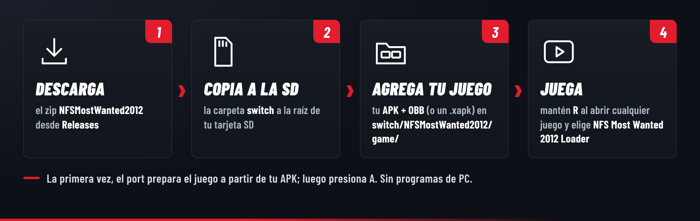

# Instalar NFS Most Wanted 2012 en la Switch

[](INSTALL.md)
[](INSTALL.es.md)

[← Volver a la página principal](../README.es.md)

> [!TIP]
> **¿Es tu primera vez con homebrew en la Switch?** Primero necesitas una consola con firmware
> modificado (Atmosphère) y el Homebrew Menu. La guía de la comunidad
> [switch.hacks.guide](https://switch.hacks.guide/) (en inglés) lo explica paso a paso. Las palabras
> técnicas de esta página están explicadas en el [glosario](#glosario).

- [Qué necesitas](#qué-necesitas)
- [Tus archivos del juego](#tus-archivos-del-juego)
  - [Sacar los archivos de tu propio teléfono](#sacar-los-archivos-de-tu-propio-teléfono)
- [Instalación](#instalación)
- [La primera vez](#la-primera-vez)
- [Abrir el juego](#abrir-el-juego)
- [La carpeta del port](#la-carpeta-del-port)
- [Actualizar](#actualizar)
- [Partidas guardadas y respaldos](#partidas-guardadas-y-respaldos)
- [Opcional: el script para PC](#opcional-el-script-para-pc)
- [Solución de problemas](#solución-de-problemas)
- [Reportar un error](#reportar-un-error)
- [Glosario](#glosario)

## Qué necesitas

- Una Nintendo Switch con [Atmosphère](https://github.com/Atmosphere-NX/Atmosphere) y el Homebrew
  Menu. Usa **emuMMC** y guarda un respaldo de tu tarjeta SD.
- Tu propia copia del juego para Android, versión **1.3.128**.
- Alrededor de **1 GB** libre en la tarjeta SD.
- Una computadora solo para copiar archivos a la tarjeta SD (o cualquier otra forma que uses para
  copiar archivos a ella).

## Tus archivos del juego

Este proyecto **no incluye ningún archivo del juego**. Los sacas de tu propia copia de *Need for
Speed Most Wanted* para Android, versión **1.3.128** (paquete `com.ea.games.nfs13_row`):

> [!NOTE]
> Solo funciona la versión **Android**. Las versiones de PC, PlayStation 3, Xbox 360, PS Vita, Wii U
> e iOS de Most Wanted (2012) son otros programas, y sus archivos no sirven.

| Archivo | Qué es |
|---|---|
| **APK**, con cualquier nombre que termine en `.apk` | La app de Android: el código del juego (5 librerías en `lib/armeabi-v7a/`) y archivos pequeños. Debe traer la versión de **32 bits**, `lib/armeabi-v7a`; los APK que solo traen la de 64 bits (`arm64-v8a`) no funcionan. |
| **OBB**, `main.1003128.com.ea.games.nfs13_row.obb` (unos 650 MB) | Los datos del juego: autos, pistas, texturas, sonidos. Es un archivo zip que el juego abre por sí mismo, así que debe quedar **tal cual**: no lo descomprimas. |
| o un solo **`.xapk`** (o `.apks`) | Un paquete con los dos adentro. Cópialo tal cual: el port saca de ahí el APK y el OBB. |

### Sacar los archivos de tu propio teléfono

Si tienes el juego instalado en tu teléfono Android, los dos archivos ya están ahí:

- **El OBB**: en el almacenamiento del teléfono, en `Android/obb/com.ea.games.nfs13_row/`, con el
  nombre `main.1003128.com.ea.games.nfs13_row.obb`. Conecta el teléfono a una computadora con un
  cable USB, elige **Transferencia de archivos** en el teléfono y copia el archivo de esa carpeta.
  (Las versiones recientes de Android ocultan `Android/obb` a las apps del propio teléfono, pero una
  computadora normalmente sí puede verla.)
- **El APK**: Android no lo muestra como archivo, pero una app tipo "APK Extractor" de la Play Store
  puede guardar el APK de una app instalada. Elige *Need for Speed Most Wanted* y copia el `.apk`
  guardado a tu computadora. Si en lugar de eso guarda varios archivos o un `.apks`, copia eso: el
  port también lee paquetes.
- **Revisa la versión**: en *Ajustes → Aplicaciones → Need for Speed Most Wanted* del teléfono, la
  versión debe ser **1.3.128**.

Si sabes usar `adb`: `adb shell pm path com.ea.games.nfs13_row` muestra dónde está el APK, y
`adb pull` lo copia (y el OBB desde `/sdcard/Android/obb/com.ea.games.nfs13_row/`).

## Instalación



1. En la página de [Releases](../../../releases), en la sección **Assets**, descarga
   `NFSMostWanted2012-<versión>.zip`. (No "Source code (zip)": eso es solo el código fuente, para
   desarrolladores.) Descomprímelo en tu computadora.
2. Copia la carpeta `switch` que trae a la **raíz** de tu tarjeta SD. (Si tu tarjeta ya tiene una
   carpeta `switch`, las dos se juntan; no se toca nada más de lo que tengas ahí.)
3. Copia tu APK y tu OBB en `switch/NFSMostWanted2012/game/`. No los descomprimas ni les cambies el
   nombre. Si tu copia es un solo `.xapk`, copia solo ese archivo.
4. Vuelve a poner la tarjeta SD en la Switch y [abre el juego](#abrir-el-juego).

## La primera vez

Si las librerías, los assets o el OBB del juego todavía no están en su lugar, el port los prepara
solo antes de abrir el juego. Una pantalla de texto muestra lo que está haciendo:

1. **Corrige los errores de copia más comunes**: librerías que quedaron en `lib/armeabi-v7a/` o
   sueltas en `game/`, una carpeta `assets` un nivel más adentro (o su contenido suelto en `game/`),
   el OBB en una subcarpeta (la `Android/obb/...` de un paquete descomprimido) o con otro nombre.
   Esos archivos simplemente se mueven a su lugar.
2. **Saca de tu APK lo que todavía falta**: las 5 librerías y la carpeta `assets`. De un `.xapk`
   también copia el OBB. Cada archivo se comprueba con la suma de verificación del paquete.
3. Cuando termina, presiona **A**: el port se vuelve a abrir, directo al juego.

Esto tarda unos segundos con un APK, o cerca de un minuto con un `.xapk` (por la copia del OBB de
650 MB). Pasa una sola vez. Después ya no necesitas el APK (o el `.xapk`) y puedes borrarlo de
`game/` para liberar espacio. Tu APK nunca se modifica.

Si algo no puede funcionar, el port te dice por qué en lugar de abrirse: un APK que solo trae la
versión de 64 bits, un archivo dañado o falta de espacio libre.

## Abrir el juego

Mantén presionado **R** mientras abres **cualquier juego** desde el menú HOME. El Homebrew Menu se
abre con toda la memoria de un juego (modo *title takeover*). Elige **NFS Most Wanted 2012 Loader**
(de SantiBros).

> [!WARNING]
> No lo abras desde el Homebrew Menu del **Álbum**: ahí el homebrew solo recibe unos 440 MB de
> memoria, y no le alcanza al juego. Si lo intentas, el port muestra un aviso.

El juego funciona a **1280×720** en modo portátil y a **1920×1080** en el dock. Desde la 0.3.0
puedes poner o sacar la consola del dock mientras juegas: el port cambia a la nueva resolución al
momento (con una pausa corta). Las versiones anteriores mantenían la resolución con la que arrancó
el juego.

## La carpeta del port

```
sd:/switch/NFSMostWanted2012/
├── NFSMostWanted2012-<versión>.nro   el port
├── README.txt                        la guía del jugador (en inglés)
├── LICENSES.txt                      componentes de código abierto y sus licencias
├── game/                             TUS archivos del juego (nunca los compartas ni los subas)
│   ├── main.1003128.com.ea.games.nfs13_row.obb   el OBB, sin cambios
│   ├── <tu APK>.apk                  se puede borrar después de la primera vez
│   ├── lib/                          libapp.so, libc++_shared.so, libfmodex.so,
│   │                                 libfmodevent.so, libNimble.so
│   └── assets/                       los assets del APK
├── save/
│   ├── progress/                     tu carrera: nfstr_save.sb
│   └── settings/                     los ajustes del propio juego: idioma, versión, acuerdo
├── cache/                            la caché del port (listas de código traducido; se puede borrar)
├── source/                           el código fuente del port (no hace falta para jugar)
├── settings.ini                      los ajustes del port (se crea la primera vez)
└── log.txt                           qué pasó la última vez que lo abriste
```

Puedes cambiar el nombre de la carpeta y del `.nro`, o moverlos: el port siempre usa la carpeta
desde la que se abrió. Puedes borrar `source/` si necesitas espacio.

## Actualizar

1. Copia la carpeta `switch` de la nueva versión en la tarjeta SD, igual que al instalar. `game/`,
   `save/` y `settings.ini` se conservan.
2. La nueva versión borra el `.nro` de las versiones anteriores de su carpeta la primera vez que se
   abre (nunca uno más nuevo). También puedes borrar tú el `.nro` viejo: con dos `.nro` en la
   carpeta, el Homebrew Menu muestra los dos.
3. Reemplaza también `source/` por la nueva, si la conservas.

**Si vienes de 0.1.0 a 0.2.0** (carpeta `switch/NFSMostWanted/`) o de una versión de prueba
(`switch/nfsmw/`): solo copia la nueva carpeta `switch` y abre **NFS Most Wanted 2012 Loader**. La
primera vez mueve tus archivos del juego, tu progreso y tus ajustes de la carpeta vieja a
`switch/NFSMostWanted2012/`, y borra la versión vieja. Solo toca la carpeta vieja si de verdad
contiene archivos de este port, y nunca sobrescribe nada.

## Partidas guardadas y respaldos

El juego guarda toda tu carrera en un solo archivo:

```
switch/NFSMostWanted2012/save/progress/nfstr_save.sb
```

El dinero (SP), la reputación y el rango Most Wanted, los autos y sus mejoras, y los eventos que
hiciste están todos dentro de él. Copia ese archivo para respaldar tu carrera, y vuelve a copiarlo
para recuperarla. Los ajustes del propio juego (idioma, acuerdo aceptado) están en `save/settings/`.

## Opcional: el script para PC

`prepare_sd.py` (viene en el zip de la descarga, necesita Python 3) hace la preparación de la
primera vez en una computadora, antes de poner la tarjeta SD en la consola. Además puede ponerle al
port **el ícono del propio juego** a partir de tu APK, para que el Homebrew Menu muestre el ícono de
Need for Speed (necesita `pip install pillow`). El `.nro` publicado nunca trae imágenes de EA.

Con la tarjeta SD como unidad `E:` (todo en una sola línea):

```
python prepare_sd.py --apk NFS_MW.apk --obb main.1003128.com.ea.games.nfs13_row.obb --nro E:\switch\NFSMostWanted2012\NFSMostWanted2012-0.3.1.nro --out E:\switch\NFSMostWanted2012
```

En macOS / Linux: `python3 prepare_sd.py ... --out /Volumes/SD/switch/NFSMostWanted2012`.

El script revisa tus archivos y dice lo que hizo: `libapp.so sha256 a73dcc17...: 1.3.128
(armeabi-v7a)` quiere decir que tu APK es la versión probada.

## Solución de problemas

Los mensajes del port salen en inglés; aquí está qué significan y qué hacer.

| Mensaje o problema | Qué hacer |
|---|---|
| **"Game files missing"** (faltan archivos del juego) | Pon tu APK (o `.xapk`) en `switch/NFSMostWanted2012/game/` y vuelve a abrirlo: el port saca de ahí lo que necesita. |
| **"Game data missing"** (faltan los datos del juego) | El OBB no está en `game/`. Copia ahí `main.1003128.com.ea.games.nfs13_row.obb`, sin cambios (o pon ahí tu `.xapk`). |
| **"... is not a valid OBB"** (no es un OBB válido) | El OBB debe ser el archivo original. No lo descomprimas, conviertas ni vuelvas a comprimir. |
| **"Setting up the game did not work"** (la preparación falló) | El mensaje dice por qué: un APK que solo trae la versión de 64 bits (usa uno con `lib/armeabi-v7a`), un archivo dañado (vuelve a copiarlo) o falta de espacio libre. |
| **"Please start the Homebrew Menu in title-takeover mode"** | Mantén **R** al abrir un juego y luego abre el port. Ver [Abrir el juego](#abrir-el-juego). |
| **"A game file is damaged"** (un archivo del juego está dañado) | Una de las bibliotecas del juego en `game/lib/` quedó cortada o dañada (una copia interrumpida o un error de la tarjeta SD). El port ya la borró: vuelve a poner tu APK en `game/` y ábrelo otra vez, y saca de ahí una copia nueva. Si pasa seguido, revisa tu tarjeta SD en una computadora. |
| **El juego se cierra justo después de abrirlo** | Actualiza a la 0.2.8 o posterior: corrige un cierre al abrirlo que pasaba en algunas consolas. Si sigue cerrándose, mira el final de `log.txt`: desde la 0.2.8, una sección `CRASH` o una línea marcada `E/` dice qué pasó. Revisa que lo abras en modo title takeover (**R + un juego**). Luego, por favor, [repórtalo](#reportar-un-error) con `log.txt`. |
| **Después de jugar un buen rato, un auto no aparece en el garaje y luego una carrera queda en negro** | Actualiza a la 0.3.1 o posterior. Hasta la 0.3.0 el port se quedaba sin hilos después de unas 90 cargas de autos y carreras (más o menos una hora de juego, antes si miras muchos autos); `log.txt` muestra entonces `pthread_create failed`. |
| **El juego se cierra o la pantalla queda negra** | En `settings.ini`, prueba `direct_memory=off` y después `gl_thread=off` (de a uno; cada cambio se aplica al volver a abrirlo). |
| **Pocos FPS** | Abre el menú de depuración (ZL + ZR + Menos) y pon *Frame-rate counter: full*. `log.txt` escribe cada 10 segundos una línea `perf:` que termina diciendo qué frena los FPS (código del juego, driver gráfico o GPU). Subir el reloj de la CPU ayuda cuando dice "game code". |
| **Tirones cortos aunque el contador marca 30** | Las líneas `perf:` de `log.txt` los cuentan ("hitches") y muestran cuánto esperó el juego a la tarjeta SD ("game waited"). Por favor [repórtalos](#reportar-un-error) con `log.txt`. Una tarjeta SD lenta o casi llena los empeora. |
| **Las cargas son lentas** | La primera vez después de instalar (o de borrar `cache/`) es la más lenta: desde la segunda vez, el port traduce el código del juego por adelantado (la caché JIT, en `cache/`). `log.txt` tiene una línea `thread ... finished after ...` por cada pantalla de carga; inclúyela en tu reporte. |
| **El sonido cruje o se distorsiona** | Baja *Sound volume* (volumen del sonido) en el menú de depuración (ZL + ZR + Menos). 70% es el valor por defecto; 100% es la mezcla completa del juego, que se corta en los momentos fuertes. Si en cambio el sonido se entrecorta, `log.txt` cuenta los "dropouts" (cortes): por favor repórtalo. |
| **La consola se congela** | Espera un momento e intenta cerrar el juego desde el menú HOME antes de mantener el botón de encendido: apagar la consola a la fuerza mientras escribe en la tarjeta SD puede dañar archivos. |
| **El Homebrew Menu muestra el port dos veces** | Todavía hay un `.nro` viejo en la carpeta: bórralo (o abre una vez la versión nueva, que lo borra sola). |

## Reportar un error

Abre un [issue](../../../issues/new/choose) y adjunta **`log.txt`** de la carpeta del port. Indica la
versión del port, las versiones de tu firmware y de Atmosphère, y si jugabas en modo portátil o en
el dock. Si el juego se cerró con un error, adjunta también el archivo más nuevo de
`sd:/atmosphere/crash_reports/`, si hay uno. Nunca adjuntes archivos del juego (APK, OBB o archivos
`.so`). Puedes escribir el issue en español.

## Glosario

| Palabra | Qué significa |
|---|---|
| **APK** | El archivo con el que se instala una app de Android. Trae el código del juego y archivos pequeños. |
| **OBB** | El archivo grande de datos de un juego de Android (autos, pistas, sonidos). Aquí: `main.1003128.com.ea.games.nfs13_row.obb`. |
| **XAPK / APKS** | Un paquete que junta el APK (y a veces el OBB) en un solo archivo. El port los lee tal cual. |
| **Atmosphère** | El firmware modificado que permite que una Switch ejecute homebrew. |
| **emuMMC** | Una copia del sistema de la Switch en la tarjeta SD, para usar el firmware modificado sin tocar el sistema propio de la consola. La forma más segura de usar homebrew. |
| **Homebrew Menu** | El menú que muestra y abre las apps homebrew (archivos `.nro`) en la Switch. |
| **Title takeover** | Abrir el Homebrew Menu manteniendo **R** al iniciar un juego, para que el homebrew reciba toda la memoria que recibe un juego. Este port lo necesita. |
| **`.nro`** | Una app homebrew para la Switch. `NFSMostWanted2012-<versión>.nro` es el port. |
| **Raíz de la tarjeta SD** | El nivel principal de la tarjeta SD, fuera de cualquier carpeta. Ahí va la carpeta `switch`. |
